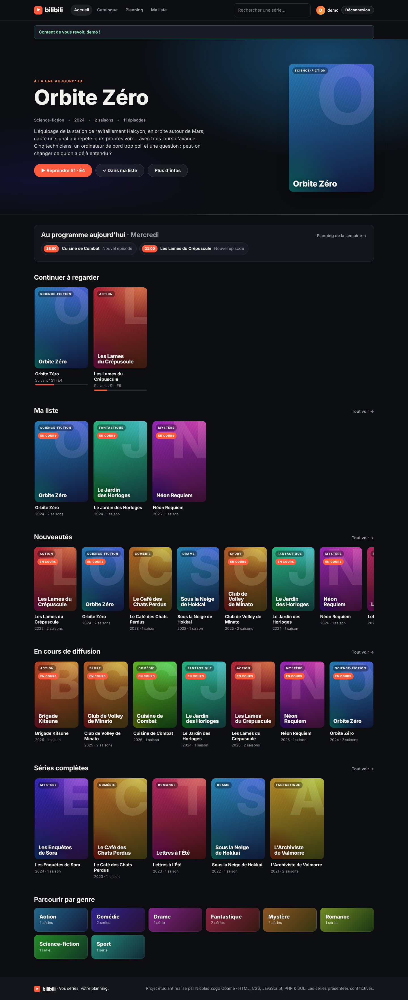
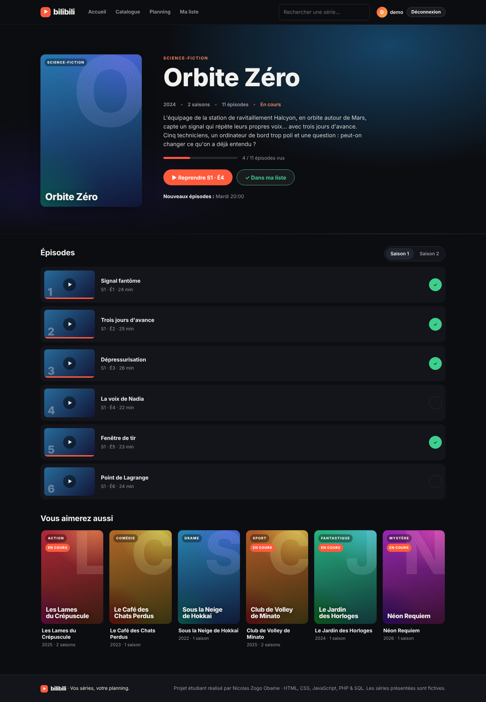
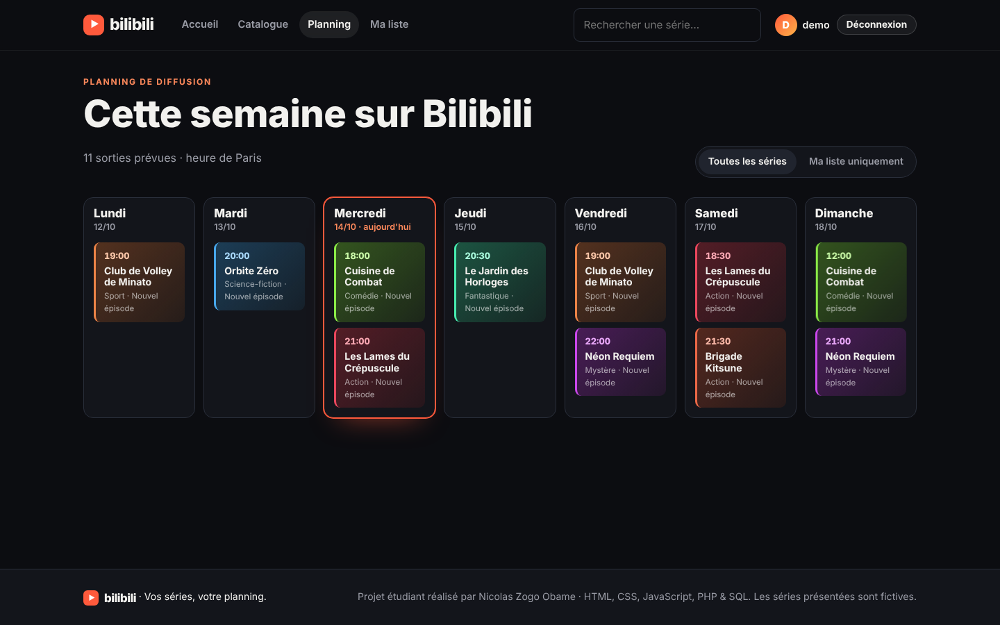
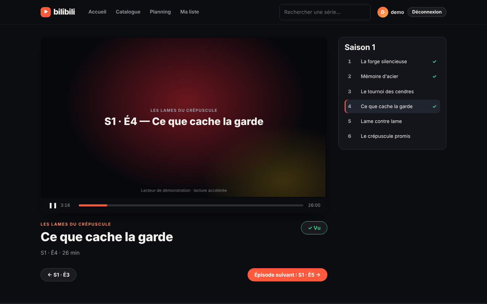
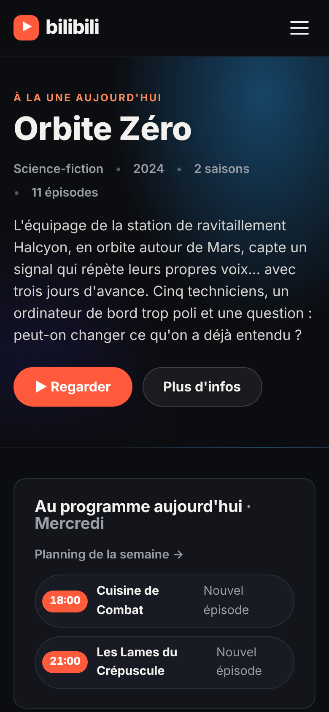

# Bilibili · plateforme de streaming de séries

Application web de streaming inspirée de Netflix, développée en **PHP 8, SQL, HTML, CSS et JavaScript**, sans framework.
Elle couvre l'inscription et la connexion des utilisateurs, la gestion de compte, un catalogue dynamique,
un planning de diffusion hebdomadaire, une liste de séries favorites et le suivi de visionnage épisode par épisode.

> **Note :** je republie ce projet dans une nouvelle version. Les fichiers d'origine ont été perdus ou étaient devenus obsolètes, je l'ai donc repris et mis à jour.



## Fonctionnalités

**Utilisateurs**
- Inscription avec validation (pseudo, e-mail, robustesse du mot de passe) et connexion par e-mail **ou** pseudo
- Gestion du compte : modification du profil et du mot de passe, statistiques de visionnage, suppression du compte
- Limitation des tentatives de connexion (blocage temporaire après 5 échecs)

**Catalogue et visionnage**
- Accueil dynamique : série à la une (change chaque jour), sorties du jour, « Continuer à regarder », nouveautés…
- Catalogue avec recherche, filtres par genre et statut, et tri
- Fiche série : saisons, épisodes, progression, créneaux de diffusion, suggestions
- Lecteur de démonstration : lecture accélérée, épisode marqué comme vu à la fin, passage automatique à l'épisode suivant
- « Ma liste » (favoris) et historique des épisodes vus

**Planning**
- Planning de la semaine (lundi → dimanche) avec mise en avant du jour courant
- Filtre « Ma liste uniquement » pour ne voir que les sorties des séries suivies

**Administration** (compte `admin`)
- Ajout et suppression de séries, d'épisodes et de créneaux du planning
- Statistiques globales (utilisateurs, séries, épisodes, visionnages)

| Fiche série | Planning |
|---|---|
|  |  |

| Lecteur | Mobile |
|---|---|
|  |  |

## Lancer le projet

Prérequis : **PHP 8.1 ou plus** avec l'extension `pdo_sqlite`.

**Le plus simple (Windows)** : double-cliquer sur `lancer.bat`. Le site s'ouvre sur http://localhost:8000
(PHP doit être installé, par exemple via XAMPP dans `C:\xampp`). Sur macOS / Linux : `./lancer.sh`.

**En ligne de commande**, depuis le dossier du projet :

```bash
php -S localhost:8000 -t public
```

**Avec XAMPP / WAMP / MAMP** : placer le dossier `bilibili` dans `htdocs` (ou `www`), démarrer Apache,
puis ouvrir http://localhost/bilibili/.

La base SQLite est **créée et remplie automatiquement** à la première visite. S'il manque quelque chose
(version de PHP, extension SQLite…), une page explique quoi corriger.

Comptes de démonstration :

| Rôle | Identifiant | Mot de passe |
|---|---|---|
| Membre (avec historique) | `demo@bilibili.local` | `Demo1234` |
| Administrateur | `admin@bilibili.local` | `Admin1234` |

Pour réinitialiser les données : `php database/init.php --reset`

### Avec MySQL (XAMPP, WAMP, MAMP…)

1. Définir les variables d'environnement `DB_DRIVER=mysql`, `DB_HOST`, `DB_NAME`, `DB_USER` et `DB_PASS`
   (ou modifier directement les valeurs par défaut dans `config/config.php`).
2. Lancer `php database/init.php` : la base, les tables et les données de démo sont créées.
3. Faire pointer le serveur web sur le dossier `public/`.

## Architecture

```
bilibili/
├── lancer.bat / lancer.sh    Lancement en un double-clic
├── config/config.php         Configuration (base de données, sécurité)
├── database/
│   ├── schema.sqlite.sql     Schéma SQLite
│   ├── schema.mysql.sql      Schéma MySQL / MariaDB
│   ├── seed.php              Données de démonstration
│   ├── installer.php         Création des tables + insertion des données
│   └── init.php              Script d'installation en ligne de commande
├── src/
│   ├── bootstrap.php         Chargé par chaque page : config, session, en-têtes de sécurité
│   ├── db.php                Connexion PDO et requêtes préparées
│   ├── auth.php              Inscription, connexion, contrôle d'accès
│   ├── series.php            Accès aux données (séries, épisodes, planning, favoris, historique)
│   ├── helpers.php           Échappement, CSRF, messages flash, utilitaires
│   └── view.php              Composants d'affichage (affiches, cartes, rangées)
├── templates/                En-tête et pied de page communs
└── public/                   Seul dossier exposé par le serveur web
    ├── index.php, catalogue.php, serie.php, regarder.php, planning.php, ma-liste.php
    ├── inscription.php, connexion.php, deconnexion.php, compte.php, admin.php
    ├── favori.php, vu.php    Actions (formulaire classique ou appel JavaScript)
    └── assets/               CSS et JavaScript
```

### Modèle de données

```
utilisateurs (id, pseudo, email, mot_de_passe, role, cree_le)
series       (id, slug, titre, synopsis, genre, annee, statut, teinte, cree_le)
episodes     (id, serie_id → series, saison, numero, titre, duree_min)
planning     (id, serie_id → series, jour, heure, libelle)
favoris      (utilisateur_id → utilisateurs, serie_id → series, ajoute_le)
visionnages  (utilisateur_id → utilisateurs, episode_id → episodes, vu_le)
```

Les suppressions se propagent en cascade : supprimer une série retire ses épisodes et ses créneaux,
supprimer un compte retire sa liste et son historique.

## Sécurité

- Mots de passe hachés avec `password_hash()` (bcrypt), avec mise à jour automatique du hachage
- Requêtes préparées PDO partout : pas d'injection SQL
- Échappement systématique des sorties avec `htmlspecialchars()` : pas de XSS
- Jeton CSRF sur tous les formulaires et toutes les actions (y compris la déconnexion)
- Régénération de l'identifiant de session à la connexion (protection contre la fixation de session)
- Cookies de session `HttpOnly` et `SameSite=Lax`, en-têtes `X-Frame-Options` et `X-Content-Type-Options`
- Redirections limitées aux pages internes (pas de redirection ouverte)
- Seul le dossier `public/` est exposé : configuration, code et base de données restent inaccessibles depuis le navigateur

## Choix techniques

- **Sans framework**, pour montrer la maîtrise des bases : routage par fichiers, sessions, PDO, rendu côté serveur.
- **Amélioration progressive** : tout fonctionne sans JavaScript. Le JS ajoute les actions sans rechargement
  (Ma liste, épisode vu), le menu mobile, le lecteur et la jauge de mot de passe.
- **Affiches générées en CSS** à partir d'une teinte stockée en base : aucune image externe à gérer.
- **SQLite par défaut** pour un lancement en une commande, **MySQL** pris en charge grâce à PDO.

## Pistes d'amélioration

- Lecture de vraies vidéos (balise `<video>`, stockage des fichiers, reprise à la seconde près)
- Limitation des tentatives de connexion par adresse IP plutôt que par session
- Réinitialisation du mot de passe par e-mail
- Tests automatisés (PHPUnit)

---

Projet réalisé par **Nicolas Zogo Obame**, étudiant en Bachelor Ingénierie du Web à l'ESGI Grenoble.
Les séries présentées sont fictives et ont été créées pour les besoins du projet.
